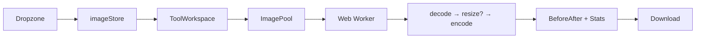

# Comprimage

Fast, privacy-first image toolkit. Resize, compress, and convert images entirely in your browser — images never leave your device. No uploads, no accounts, no waiting.

Live at **https://comprimage.my.id**

## Features

- **Resize** — scale by width, height, longest edge, or percentage; aspect ratio locked, upscaling blocked
- **Compress** — quality slider with live savings preview at full resolution
- **Convert** — move between JPG, PNG, WebP, and AVIF
- **Batch** — queue multiple images and download results as a ZIP
- **Settings** — theme preference, default output format/quality, worker concurrency

## Tech stack

- [TanStack Start](https://tanstack.com/start) (static prerendering), [TanStack Router](https://tanstack.com/router), React 19
- Tailwind CSS 4, [shadcn/ui](https://ui.shadcn.com/) (Radix)
- Zustand for image and settings state
- Web Workers + Canvas API for image processing
- Vitest, ESLint, Prettier
- Bun for install/build; Docker + nginx for production

## Project structure

```
comprimage/
├── docker/nginx/          # nginx prerendered-route config
├── public/                # favicon, social, robots, and error assets
├── scripts/               # SEO verification
├── src/
│   ├── components/        # UI by domain (upload, preview, controls, batch, layout, ui)
│   ├── hooks/             # useImageProcessor, useImageQueue
│   ├── lib/               # pipeline (process, resize, compress, convert, canvas, zip, download)
│   ├── routes/            # file-based pages (index, resize, compress, convert, batch, settings)
│   ├── stores/            # imageStore, settingsStore
│   ├── types/             # shared image/pipeline types
│   └── workers/           # image.worker.ts + ImagePool
├── Dockerfile
├── docker-compose.yml
└── DESIGN.md              # design tokens / visual system reference
```

### Routes

| Path        | Purpose                                     |
| ----------- | ------------------------------------------- |
| `/`         | Home — dropzone and tool overview           |
| `/resize`   | Scale images with live before/after preview |
| `/compress` | Shrink file size at the same dimensions     |
| `/convert`  | Change output format                        |
| `/batch`    | Process multiple images, download as ZIP    |
| `/about`    | Local processing and codec details          |
| `/settings` | Theme, defaults, and worker concurrency     |

## How it works

Users drop or select images via a shared dropzone. Imports inspect metadata before decoding and accept at most 50 MiB and 25 megapixels per image. Batch mode holds up to 50 loaded images and 100 megapixels across repeated additions, reads at most two images at once, preserves selection order, and reports skipped files individually. Imports can be cancelled; unclaimed previews are released. Resized output is also limited to 25 megapixels before allocating a canvas. The source image is held in a Zustand store so it carries across the resize, compress, and convert tools. Each tool builds `ProcessOptions` from its controls and hands them to a shared `ToolWorkspace`, which drives processing through an `ImagePool` of Web Workers.

The pipeline is **decode → (optional resize) → encode → Blob**, implemented in `src/lib/process.ts`. Object URLs are minted on the main thread (blob URLs created inside a worker are not reliably usable from the document). When Web Workers or OffscreenCanvas are unavailable, processing falls back to the main thread, one task at a time. Worker errors, unreadable messages, dispatch failures, and five-minute timeouts settle the affected task and replace its worker. Timeouts start at dispatch; failed tasks are not retried automatically. Option changes, removal, clearing, and unmounting cancel obsolete tasks. Browser decoding and main-thread codecs may finish after cancellation, but their stale output is discarded.



## Getting started

Requires [Bun](https://bun.sh/) 1.4 or newer. `bun.lock` is the authoritative lockfile. Its version 3 format supports scoped dependency overrides and cannot be read by older Bun versions.

```bash
bun install
bun run dev        # http://localhost:3000
bun run build
bun run preview
bun run test
bun run lint
bun run format
bun run check
```

`build` prerenders every route and verifies the generated SEO metadata, sitemap, social image, and initial bundle size. The Docker image uses Bun because the `oven/bun` image has no `node` binary.

## Deployment (Docker)

Comprimage is a **100% client-side application with prerendered static HTML** (no backend, no database). It ships as a two-stage container: a **Bun** build stage produces the static output (`dist/client`), and an **nginx** stage serves it.

Files:

- `Dockerfile` — shared `dependencies` stage (`bun install --frozen-lockfile`) fanning out to a `development` stage (Vite dev server) and a `build` → `production` stage (`bun run build` → `nginx:1.30.6-alpine` serving `dist/client`)
- `docker/nginx/comprimage.conf` — clean prerendered route serving, real document/asset 404s, `no-cache` headers for branding assets, and long-lived caching for hashed `/assets`
- `docker-compose.yml` — two Compose profiles: `web-dev` (`--profile dev`) and `web-prod` (`--profile prod`, on the external `edge` network)
- `.env.example` — copy to `.env` to override `FRONTEND_DEV_PORT` (dev host port) and `IMAGE_TAG` (prod image)

Local development (hot-reloading Vite dev server on `http://localhost:3000`, source bind-mounted):

```bash
docker compose --profile dev up --build
```

Production:

```bash
docker compose --profile prod up -d --build
```

TLS and routing are handled by the shared **Traefik** edge proxy (Let's Encrypt). The `web-prod` container joins the `edge` Docker network and publishes **no** host ports; routing is configured via Traefik labels on the `web-prod` service in `docker-compose.yml`.

> `vite.config.ts` pins the prerender preview server to `127.0.0.1` so the build's prerender step is reliable inside containers.

Validate a local production container with `docker exec <container> nginx -t` and `NGINX_ORIGIN=http://127.0.0.1:8088 bun scripts/verify-nginx.mjs`. The verifier expects the matching build assets under `dist/client/assets`; set `NGINX_ASSETS_DIR` when testing assets copied from a container. It checks health, routes, redirects, missing files, cache revalidation, and codec MIME types.

### CI

On push to `main`, [`.github/workflows/deploy.yml`](.github/workflows/deploy.yml) builds the Docker image, pushes it to GHCR (`ghcr.io/rifkifajarramadhani/comprimage`), and SSH-deploys to the production host.

The build generates `dist/nginx/security-headers.conf` outside `dist/client` by
hashing inline scripts in every emitted HTML document, including hydration and
error documents. The Docker image installs this nginx include and uses
`add_header_inherit merge` plus `always` to retain security headers in nested
locations and on errors. Rebuild when HTML changes; never edit deployed HTML
without regenerating the hashes.

For local CSP compatibility checks, run `bun scripts/security-headers.mjs
--report-only`, install the generated include into a local container serving the
same build, and reload nginx. Exercise themes, navigation, image previews, all
output formats, batch processing, and downloads while monitoring browser CSP
violations. Run the generator without that flag to restore enforcement, reload,
and repeat. `CSP_HEADER=content-security-policy bun scripts/verify-nginx.mjs`
also verifies headers on successful, redirect, asset, conditional, and error
responses. Use `content-security-policy-report-only` during the first pass.

Deployment requires `SSH_HOST_FINGERPRINT` alongside `SSH_HOST`, `SSH_USER`,
and `SSH_KEY` in GitHub Actions secrets. In the provider's authenticated console,
or through an already verified administrative SSH session, run:

```bash
ssh-keygen -l -E sha256 -f /etc/ssh/ssh_host_ed25519_key.pub
```

Store the `SHA256:...` field exactly, without the key size or comment. Verify the
host key type actually presented by the deployment server. The workflow rejects
missing or malformed fingerprints before the SSH action starts, and the action
rejects a fingerprint mismatch. Do not establish trust using `ssh-keyscan` over
an unverified connection. Obtain a rotated fingerprint through the trusted
channel before updating the secret. Configuring production secrets and deploying
remain operational steps outside these local changes.
